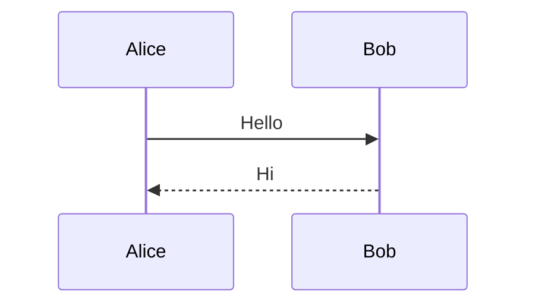

# Edge Cases

5. Starts at five
6. Six
    - nested bullet in ordered
        1. deep ordered
7. Seven

- Bullet with **bold** and `code`
    1. ordered child
    2. second child
- [ ] Task with a very long line of text that should wrap onto the next line and keep the hanging indent aligned with the text start

> [!note] Outer callout
> Text in the outer callout.
> > [!warning] Inner callout
> > - list in inner
> > - second item
> >
> > ```js
> > const nested = true;
> > ```

> Quote with a list
> - one
> - two
>
> And `code` too.

Sized image: ![[gradient.png|200]]

Emoji 🎉 and CJK 漢字かな and ünïcödé.

A [link with `code`](https://example.com) and ==highlighted [[Embedded Note]]==.

| Left | Multi-line |
| :-- | :-- |
| a | first<br>second<br>third |

| C1 | C2 | C3 | C4 | C5 | C6 | C7 | C8 | C9 | C10 |
| -- | -- | -- | -- | -- | -- | -- | -- | -- | -- |
| wide | table | with | many | columns | that | might | overflow | the | page |

$$
\begin{pmatrix} a & b \\ c & d \end{pmatrix} \begin{aligned} x &= 1 \\ y &= 2 \end{aligned}
$$

Inline sum $\sum_{i=1}^n i^2$ and fraction $\frac{a}{b}$.



![[Embedded Note#Embedded section]]

## Long table

| # | Name | Notes |
| -- | -- | -- |
| 1 | Item 1 | long text long text |
| 2 | Item 2 | long text long text long text |
| 3 | Item 3 | long text long text long text long text |
| 4 | Item 4 | long text |
| 5 | Item 5 | long text long text |
| 6 | Item 6 | long text long text long text |
| 7 | Item 7 | long text long text long text long text |
| 8 | Item 8 | long text |
| 9 | Item 9 | long text long text |
| 10 | Item 10 | long text long text long text |
| 11 | Item 11 | long text long text long text long text |
| 12 | Item 12 | long text |
| 13 | Item 13 | long text long text |
| 14 | Item 14 | long text long text long text |
| 15 | Item 15 | long text long text long text long text |
| 16 | Item 16 | long text |
| 17 | Item 17 | long text long text |
| 18 | Item 18 | long text long text long text |
| 19 | Item 19 | long text long text long text long text |
| 20 | Item 20 | long text |
| 21 | Item 21 | long text long text |
| 22 | Item 22 | long text long text long text |
| 23 | Item 23 | long text long text long text long text |
| 24 | Item 24 | long text |
| 25 | Item 25 | long text long text |
| 26 | Item 26 | long text long text long text |
| 27 | Item 27 | long text long text long text long text |
| 28 | Item 28 | long text |
| 29 | Item 29 | long text long text |
| 30 | Item 30 | long text long text long text |
| 31 | Item 31 | long text long text long text long text |
| 32 | Item 32 | long text |
| 33 | Item 33 | long text long text |
| 34 | Item 34 | long text long text long text |
| 35 | Item 35 | long text long text long text long text |
| 36 | Item 36 | long text |
| 37 | Item 37 | long text long text |
| 38 | Item 38 | long text long text long text |
| 39 | Item 39 | long text long text long text long text |
| 40 | Item 40 | long text |

## Long code

```python
line 001 = compute(1) # comment 1
line 002 = compute(2) # comment 2
line 003 = compute(3) # comment 3
line 004 = compute(4) # comment 4
line 005 = compute(5) # comment 5
line 006 = compute(6) # comment 6
line 007 = compute(7) # comment 7
line 008 = compute(8) # comment 8
line 009 = compute(9) # comment 9
line 010 = compute(10) # comment 10
line 011 = compute(11) # comment 11
line 012 = compute(12) # comment 12
line 013 = compute(13) # comment 13
line 014 = compute(14) # comment 14
line 015 = compute(15) # comment 15
line 016 = compute(16) # comment 16
line 017 = compute(17) # comment 17
line 018 = compute(18) # comment 18
line 019 = compute(19) # comment 19
line 020 = compute(20) # comment 20
line 021 = compute(21) # comment 21
line 022 = compute(22) # comment 22
line 023 = compute(23) # comment 23
line 024 = compute(24) # comment 24
line 025 = compute(25) # comment 25
line 026 = compute(26) # comment 26
line 027 = compute(27) # comment 27
line 028 = compute(28) # comment 28
line 029 = compute(29) # comment 29
line 030 = compute(30) # comment 30
line 031 = compute(31) # comment 31
line 032 = compute(32) # comment 32
line 033 = compute(33) # comment 33
line 034 = compute(34) # comment 34
line 035 = compute(35) # comment 35
line 036 = compute(36) # comment 36
line 037 = compute(37) # comment 37
line 038 = compute(38) # comment 38
line 039 = compute(39) # comment 39
line 040 = compute(40) # comment 40
line 041 = compute(41) # comment 41
line 042 = compute(42) # comment 42
line 043 = compute(43) # comment 43
line 044 = compute(44) # comment 44
line 045 = compute(45) # comment 45
line 046 = compute(46) # comment 46
line 047 = compute(47) # comment 47
line 048 = compute(48) # comment 48
line 049 = compute(49) # comment 49
line 050 = compute(50) # comment 50
line 051 = compute(51) # comment 51
line 052 = compute(52) # comment 52
line 053 = compute(53) # comment 53
line 054 = compute(54) # comment 54
line 055 = compute(55) # comment 55
line 056 = compute(56) # comment 56
line 057 = compute(57) # comment 57
line 058 = compute(58) # comment 58
line 059 = compute(59) # comment 59
line 060 = compute(60) # comment 60
line 061 = compute(61) # comment 61
line 062 = compute(62) # comment 62
line 063 = compute(63) # comment 63
line 064 = compute(64) # comment 64
line 065 = compute(65) # comment 65
line 066 = compute(66) # comment 66
line 067 = compute(67) # comment 67
line 068 = compute(68) # comment 68
line 069 = compute(69) # comment 69
line 070 = compute(70) # comment 70
```

Done.
