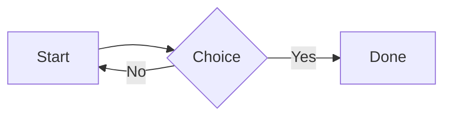

# Heading 1

Body paragraph with **bold**, *italic*, ***bold italic***, ~~strike~~, ==highlight==, `inline code`, a [link](https://obsidian.md), a [[Embedded Note]] wikilink, a [[#Heading 2|heading link]], and a #tag. Superscript<sup>2</sup> and subscript<sub>i</sub>. A footnote reference[^1] and an inline one^[Inline footnote text.].

Second paragraph to check paragraph spacing. Lorem ipsum dolor sit amet, consectetur adipiscing elit, sed do eiusmod tempor incididunt ut labore et dolore magna aliqua. Ut enim ad minim veniam, quis nostrud exercitation ullamco laboris.

## Heading 2

### Heading 3

#### Heading 4

##### Heading 5

###### Heading 6

## Lists

- Bullet one
- Bullet two
    - Nested bullet
        - Third level
- Bullet three

1. First
2. Second
    1. Nested first
    2. Nested second
3. Third

- [ ] Open task
- [x] Done task
    - [ ] Nested task

## Quotes and callouts

> A blockquote with **bold** text.
>
> > A nested quote.

> [!note]
> A note callout with a [link](https://example.com).

> [!warning] Custom title
> Warning callout body.
>
> - list inside callout

> [!tip]- Folded tip
> Hidden on screen, shown in print.

## Code

```js
// Comment
function greet(name) {
	const message = `Hello, ${name}!`;
	return message.length > 0 ? message : null;
}
```

```python
def fib(n: int) -> int:
    return n if n < 2 else fib(n - 1) + fib(n - 2)
```

## Table

| Left | Center | Right |
| :--- | :----: | ----: |
| a | **b** | 1 |
| longer cell text | `code` | 22 |

---

## Math

Inline math $e^{i\pi} + 1 = 0$ in a sentence.

$$
\int_0^\infty e^{-x^2}\,dx = \frac{\sqrt{\pi}}{2}
$$

## Mermaid



## Image

![[gradient.png]]

## Embed

![[Embedded Note]]

## Columns

> [!columns|40 60]
> ### Left
> - fast
> - cheap
>
> > [!column-break]
>
> ### Right
> Some text in the right column that is a bit longer to wrap.

Final paragraph after columns.

[^1]: The first footnote.
